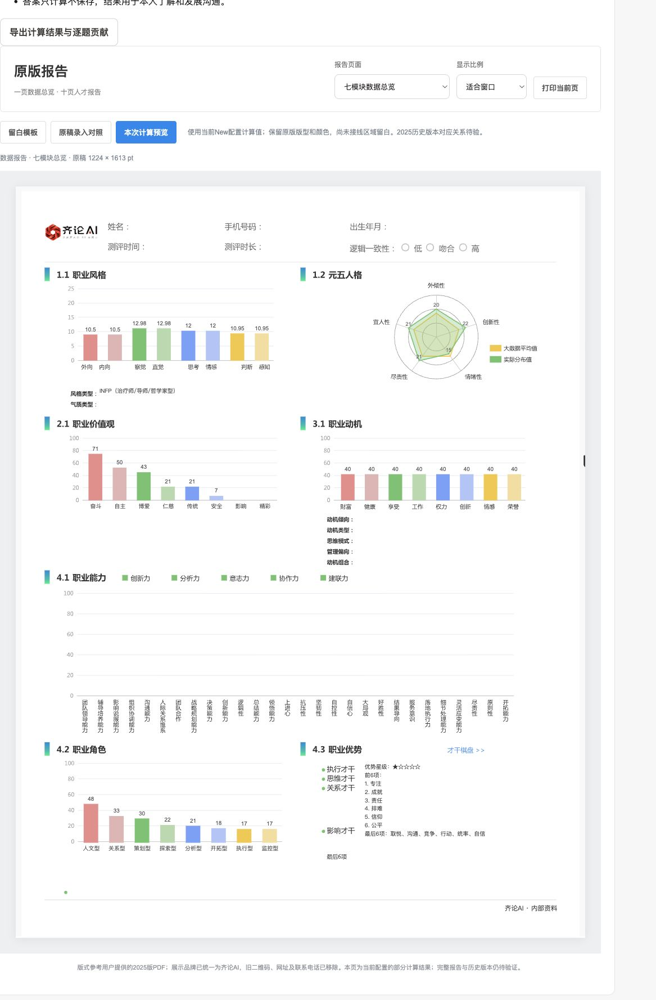

# 2026-10-05：v22补充与双轮验收

在已有工程上继续，没有重建系统，没有初始化或重置业务数据库、账号、加密密钥，没有修改已应用SQL迁移。项目没有本地Git或远程，未新建仓库或猜测远程地址。本次未部署公网。

## 使用入口

本地地址：`http://127.0.0.1:3100/`。登录原账号后，进入「测评中心 → 齐论测评 · 规则核验 → 10月补充 · 完整答案计算」。

可以按原题作答277题，再进行4组各选5词、20选10词、最终排序；只有进入排序阶段且答卷完整才可提交。也可以导入完整答案JSON。草稿能导出并恢复题目、页码、价值选择和排序；答案只在当前页面内存中保存，离开前应导出。此入口不保存为人才正式报告，也不发出候选人邀请。原24题独立自评仍在，不能混作原版277题。

## 已补入的逻辑

| 计算链 | 本次实现与边界 |
|---|---|
| 普通题与价值观 | 277题及10项价值名次严格校验，当前单陈述编码1完全符合至5完全不符；旧反向编码须显式旧版本。32词排列仅代表已归档排列，不代表全部历史动态排列。 |
| 基础分与校准 | type2/3/4/5逐题贡献、分段校准；原始分与校准分分开；未选择的价值维度为null，不冒充零。 |
| 职业风格 | 四对维度由答案算出，同分取右，得到INFP；不再需要客户端传入C4Top。 |
| 性格及职业角色 | type16的36子项与6父项、8职业角色、动态B/C权重、Junior和SeniorNew校准。278–283在当前配置无规则，所示0仅适用于当前配置。 |
| 优势 | 34项完整排序与星级；保留源码阈值及小数空档，没有“优化”为另一套算法。 |
| 最终匹配 | 显式采用addSomeMatchPeoRecord，四项升序、类型平局、位置系数及HALF_UP；旧addMatch路线不混用。只有已有四项输入时能核对，不能从完整答卷直接得到正式匹配。 |
| 已取整匹配输入 | 不声称唯一历史raw；检查全部24种排序区域给出保守范围，避免近同分换序造成虚假的固定顺序精度。 |
| 岗位矩阵 | 仅移植每成员scoreCalibrateNew路线：28项原始百分数排序、取整分段、名次权重、均值与最大值、前10及第26–28名。零贡献项按源码缺席。未混入addPosi或旧scoreCalibrate。 |
| 五力与管理分组 | 从已有28项能力报告值复算5组、3组及封顶。不能以此冒充已完成“答案→能力”。 |

后台新接口均需业务角色、会话、CSRF和来源校验，严格版本及用途，返回private/no-store。客户端身份绑定、人员字段、跨卷答案、重复题号、缺项和非法选项被拒绝。正式发布与整套匹配门禁仍返回缺项，不被试算解除。

## 报告接线及视觉修正

沿用一页数据总览和十页人才报告的原稿矢量母版、配色和尺寸，不套新的红黑主题。齐论Logo、封面品牌元素和标题继续保留；旧二维码、联系方式和旧机构名称覆盖继续生效。

增加“本次计算预览”，与原稿录入对照、手填留白模板分开。自动填入风格、性格、角色、动机、价值观及优势摘要的已知字段；身份、能力条形图和未接线解释留白。当前New配置不等同于2025报告黄金版本。

浏览器检查修正了价值观名称含“型”导致图表绑定失败、雷达中心与原稿不符、价值/角色排序后标签与分数错位。雷达使用原矢量中心(904,323)/(612.5,358)和半径90/84.75；数值使用HALF_UP，未依赖浮点toFixed。打印样式仅保留当前报告，不把答题、计算表和公式核对页一起打印。真实系统打印/PDF导出尚未另作端到端验收。

截图为虚构验收账号的中立答卷，不是用户的真实结果：



## 证据与两轮检查

输入是用户提供的 `20261004-高禾全部证据原理总归纳移交包.zip`。原件与历史答卷留在私人 `.local/gh-evidence-v22/`，未上传、未纳入公开前端。只读取数据与源码，未运行包内程序、未连接原站数据库。

`scripts/import-gh-evidence-v22.py` 在导入前和导入后各做完整性核验：外层13项、递归清单4554项、11个独立嵌套包、37条索引、341条题目/价值映射。另将已用数值配置与v22嵌套包逐字节哈希对应。唯一已声明例外是v7校验脚本脱敏后的哈希与旧内部清单不同；例外绑定确定文件和脱敏后SHA-256，不放行任意修改。计分配置无该例外，不能将此描述为“全部文件原哈希一致”。

独立TypeScript引擎回归，而非直接调用包内验证函数：

- 6份完整答卷、24组类型输出，337项原始分及337项校准分容差1e-9内吻合。
- 1份真实配对样本的42项性格及56个角色数值吻合，可从完整答案独立重算。
- 93个最终匹配记录中85个整数吻合，8个相差1；缺少历史未取整组件，不能声称93个完全一致。
- 4份候选人已有28项能力值的五力、管理分组及星级吻合；证据等级仍为源码/数据库计算，不升级为完整运行返回。

第一轮完整测试77项通过，第二轮加入打印隔离检查后78项通过，均0失败、0跳过。最终源代码再次执行78项全量回归、TypeScript检查及前端构建，仍为78通过、0失败、0跳过。测试使用独立内存/临时磁盘数据库，与业务库隔离。

浏览器第一轮逐页完成70组共277题，完成价值观三步流程、调整排序、导出草稿并计算报告。第二轮重新启动最新内存验收服务，导入实际导出的草稿，确认277题与排名恢复，确认排序前不可提交；计算结果及11页模板全部加载，三个补充公式入口均成功。匹配样例结果71、岗位矩阵保留13/28项、五力与管理分组正常；无浏览器warning/error。最终构建另检查公式JSON错误提示可见、修正后恢复结果71且错误清除。打印隔离是样式及自动化检查，不冒充实际打印成功。

验收完成后关闭本次虚构内存服务43126，使用原.env启动正常平台3100；首页HTTP200，新核验接口未登录HTTP401，浏览器实际显示正常平台登录页。没有重设账号或密钥。

## 仍缺什么：可转发给补材料的人

这次不是还缺普通题。普通277题、价值观流程、基础计分及多个衍生公式已收到。要保证同样答案与旧站整份报告完全一致，还需要：

1. 同一个人的同一次完整答卷，以及那次高级报告接口实际返回的完整非空数据，连同版本信息。不要只给数据库拼出的表或截掉内容的响应。
2. 17个旧岗位模型当时实际使用的成员、每人原始分数和时间记录。现在的替代成员不能证明当时结果。
3. 剩下48种报告触发情况的实际运行输入与输出。源码能看懂条件，不等于已验证所有运行分支。
4. 2025年那两份PDF对应的实际部署版本、源码提交和算法文件SHA-256，确保不是用新算法去解释旧报告。
5. 那条职业角色分数异常的同次原始返回与前后记录，才能解释差异，不能凭现有截图猜原因。

此外，本次展开的材料中仍未找到 `AgType8Map` 的完整实现/权重表或实际算法JAR。这个是“277题答案怎么变成28项职业能力分”的关键。现有AgTypeMap只是加载器，type16/type28配置不能代替type8。请补提供与目标版本一致的完整AgType8Map或包含它的实际算法JAR，最好再附同次答卷→28能力→完整报告的配对记录。开发端的完整解释接线也仍有工作，不能把五项证据缺口当成全部剩余开发。

因此本次已推进到可核对的部分自动报告，尚不是整份一模一样的正式报告，不用于自动录用/淘汰或招聘排序。没有更改数据库/账号/密钥，也没有公网发布。

## 维护文件与复验命令

核心为 `packages/assessment-engine/gh-derived.ts`、`gh-rounding.ts` 与数据配置；接口为 `apps/api/assessment-routes.ts`；界面为 `gh-replay.tsx`、`gh-quiz-state.ts`、`gh-report-preview.tsx`、`gh-report-data.ts`、`original-report.tsx/css`。旧9月证据及独立24题/外部180题保留，不改写历史证据等级。

正常Node/npm环境运行：

```sh
python3 scripts/import-gh-evidence-v22.py
npm run build
npm test
```

导入脚本需要本机私人原证据目录；缺少它不能伪造回归数据。当前环境使用已存在的Node/Python运行环境，不安装依赖，不改动锁文件。
