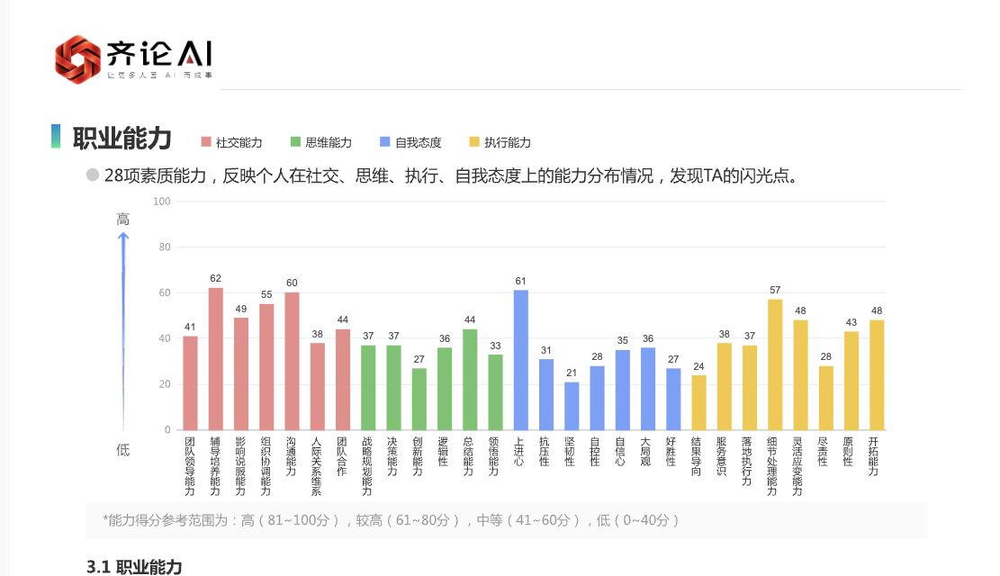

# 2026-10-06：历史结果反推与验收

本轮按用户要求，把现有计分规则、历史中间分项与结果、公开计算方法结合，实际实现并独立检查了缺失28项能力的反推入口。结果是可生成标明“估计”的能力图表，不是已恢复原版权重，也没有达到“同样答案，整份报告数字一模一样”或99%一致。

在已有工程上继续：原业务数据库、账号、加密密钥、已应用SQL迁移与原始证据未重置、未改写；没有部署公网。项目没有本地Git或远程，未新建仓库或猜测远程。

## 大白话结论

已经知道怎么算的部分，继续按收到的规则算，不改成猜测。缺少原始公式的28项能力，尝试用“历史中间分数→当时能力结果”学习对应关系，再让新的完整答卷走这条链。

真正检查后，这条反推链只能近似，不能说一模一样。平均差几分，也不等于“准确率96%”：原版显示70、我们显示73，就是差3分，仍然不是同一个数字。整份报告的解释文字与所有触发情况也尚未全量接线。

朋友无法继续补材料，不再把继续提供资料作为本轮工作的前提。可以继续用现有底座做推演，但每一条推演都要与已验证的原规则分开，不能把待验证项直接标成原版。

## 哪些数据真的可用于反推

仅使用9月30日v3服务端快照的一份规范来源，重复嵌套包不重复计人数：

- 能力输出：72,940行，2,605组，每组28项。
- 职业角色输出：21,184行，2,648组，每组8项。
- 按完整项、唯一项及生成时间筛选后：2,449组中间分项与能力输出配对，输入分组2,449个，无重复输入；未发现同组输入相差超过1分的冲突。
- 排除91组缺失或重复角色项、65组生成时间不符合配对要求的数据。
- 配对窗口：全部能力写入时间、角色最后更新时间及基础分项最后写入时间相差不超过120秒；基础分项的最早至最后写入不超过24小时。基础分项在答题过程中逐步写入，不能简单要求所有基础行同时生成。若要求全部基础及衍生行均在120秒内，仅剩35组。
- 这仍是数据库快照配对，不是2,449份已证明同版本的完整答卷和完整高级报告；实际部署版本尚未锁定。
- 能检查“完整答案→中间分项→能力”的历史样本只有6份，含重建与版本风险。它们全部留在训练之外；不能说有几千份完整277题答案。
- 现有9,196条答案回放属于另一套180题问卷，不能充作277题的训练答卷。v22清单的4,554个条目是证据文件，不是4,554份独立报告。

只读审计前后六个原JSONL的SHA-256一致。审计、模型和原答卷均保留在私人`.local/`，不进入前端资源、不上传。

## 全部模块目前如何计算

| 模块 | 当前路径 | 是否可称原版完全恢复 |
|---|---|---|
| 277题、价值选择/排序 | 沿用v22严格题号、编码、完整性与排序校验 | 当前归档配置可用，不代表全部历史动态题序 |
| 基础分、校准分 | 按已有逐题映射、分段与舍入规则计算 | 已有6份答卷回归吻合，不扩展成所有版本保证 |
| 职业风格与性格 | 四对风格、同分取右、type16现有规则 | 已知配置按原规则计算，沿用v22验证边界 |
| 职业动机、价值观 | 已有基础/校准规则 | 不用公开量表的权重替换收到的规则 |
| 34项职业优势与8职业角色 | 原优势排序、星级、角色B/C/D/Notion及Junior/SeniorNew | 沿用既有规则；一份完整真实性格/角色配对已验证 |
| 28项职业能力 | 48个历史中间特征→反推模型→28个估计值 | 否，未找回AgType8Map原映射/权重 |
| 五力、3个管理分组 | 已知分组公式作用于28个估计值 | 分组公式已知，但输入是估计，输出仍是估计 |
| 能力页四个分层 | 从估计的28项显示整数按归属求均值并排序 | 不是原SQL直接对未封顶scoreCalibrate求均值，不能称精确复原 |
| 岗位矩阵、最终匹配 | 保留原显式路线及缺项门禁 | 不把估计能力自动接入正式匹配/招聘排名 |
| 报告版式与品牌 | 继续用原稿矢量母版及配色，齐论品牌覆盖 | 本轮接上能力图及分层位置；不以截图证明数字一致 |
| 十页全文解释 | 已接线的原字段照常，未接线部分仍留白 | 尚未全量恢复，48个运行触发情况未全量验证 |
| 逻辑一致性、历史特殊分支 | 不凭其他量表或常识补一个固定值 | 尚未恢复；不能伪造原版字段 |

48个反推特征是8角色各自的`scoreB/scoreC/scoreD/scoreNotion`共32项，加8动机与8价值基础分共16项。B/C/D/Notion分别对应优势、风格、动机、价值的已知角色中间分项，不按名称猜映射；固定配置顺序，不按图表排序重新对齐。不输入能力目标值、人员身份、招聘结果或其他问卷答案。

## 公开方法如何使用

采用本地实现的RBF加线性核岭回归，用来学习多维中间分项与能力结果之间的近似对应关系。参考[核岭回归官方说明](https://scikit-learn.org/stable/modules/generated/sklearn.kernel_ridge.KernelRidge.html)。本机用已存在的NumPy实现，没有安装或调用scikit-learn，也未下载执行第三方代码。

采用独立验证与测试、逐项绝对误差和显示整数完全相同比例，参考[模型评估官方说明](https://scikit-learn.org/stable/modules/model_evaluation.html)。不把误差换算成未经定义的“准确率”。

[O*NET公开模型](https://www.onetcenter.org/content.html)可帮助理解职业维度，[IPIP计分说明](https://ipip.ori.org/newScoringInstructions.htm)适用于其自己的条目。它们不能证明这套277题的商业原版权重，所以本轮没有拿这些权重冒充AgType8Map。

## 独立检查结果

按近似输入分组后固定划分：训练1,440组、选参数的验证501组、独立测试508组。9个候选参数仅根据验证集选择，最终gamma=0.1、alpha=0.1、linear_weight=1；不根据测试结果调参，不把独立测试重新纳入训练。6份完整答卷及相同输入组也预留在训练之外。

目标是旧数据库`scoreCalibrate×100`，封顶100后HALF_UP得到的显示整数；不是已证明与2025原站运行完全同版的结果。

| 检查对象 | 能力数字完全相同 | 差不超过1分 | 每项平均绝对差 | 95%误差分位数 | 最大差 | 28项全部相同的整组比例 |
|---|---:|---:|---:|---:|---:|---:|
| 501组验证中间分项／14,028个数字 | 10.53% | 31.00% | 3.60分 | 10分 | 30分 | 0% |
| 508组独立测试中间分项／14,224个数字 | 10.53% | 30.43% | 3.65分 | 10分 | 29分 | 0% |
| 6份完整答案链／168个数字 | 3.57% | 13.69% | 5.86分 | 13.65分 | 22分 | 0% |

上述比例仅衡量缺失28项能力与归档结果的数值一致性，不是整个平台的正确率，也不是人格测评效度或招聘预测准确率。误差分位数是历史测试样本统计，不是当前个人的置信区间。6份答卷不够代表人群，且历史版本风险会影响端到端检查。

目前保留的角色中间分项会压缩原始优势名次等信息，未知能力映射和版本差异可能继续造成误差；本轮数据不足以分辨并证明每一种误差的唯一原因。该模型不是唯一原始公式的逆解，也没有证明继续研究一定能达到99%。

## 平台入口与隔离

正常本地平台：`http://127.0.0.1:3100/`。用原账号登录，进入「测评中心 → 齐论测评 · 规则核验 → 10月补充 · 完整答案计算」，勾选“启用历史结果反推，补出28项能力估计（非原版实算）”。支持完整277题和价值排序作答或导入既有完整答案格式。

默认仍走已知原规则，只有显式勾选才启用估计；不绑定候选人、不写入人才正式报告、不发邀请、不解除正式发布或招聘排序门禁。能力明细、汇总及报告页均标明估计；远离训练输入邻域时另显示不可靠提示。未经原版验证不用于自动录用或淘汰。

服务端接口：`GET /api/v1/assessment/gh-inference`、`POST /api/v1/assessment/gh-inference/score`。沿用登录、业务角色、CSRF、来源及严格版本/用途校验，返回private/no-store。公共摘要按字段白名单仅返回计数和误差；不返回支持向量、系数、标准化参数、原答卷或人员ID。模型缺失/损坏时禁用推算，不影响原v22路径。

使用原.env正常重启3100程序，确认先退出唯一旧进程再启动，未运行第二个业务库实例。首页HTTP200，新接口未登录HTTP401。

## 两轮检查与页面结果

- 两轮完整测试均85通过、0失败、0跳过、0取消。此前沙箱网络限制导致的HTTP测试等待被中止，没有计为通过；在允许本地测试监听的环境中完成两轮。
- TypeScript检查及前端生产构建通过。原78项回归继续通过，新增7项覆盖48项映射、模型验证、Python/TypeScript数值一致、误差与隐私白名单、估计来源标记、域外输入和接口安全/不写业务数据。
- 网页检查使用独立内存数据库和虚构全中立答卷，不使用业务账号、真实报告或业务库。检查并修正了能力图表与四个分层框的坐标及数字格式；原配色保留。
- 实际打开反推入口并计算，28项能力和四分层可见。刷新最新构建重算后无浏览器warning/error。真实277题逐题作答流程沿用v22已验收流程，本轮没有声称重新手答全部277题。
- 下图仅是虚构答卷的反推预览，裁图未包含页底估计标签；实际报告页包含“能力为反推估计 · 非原版实算 · 不作自动录用依据”标签。截图不是原站数字复现证据。



## 仍未闭合的原版目标

没有找回AgType8Map原始权重/实现。v22五项历史缺口仍未被近似模型消除：同次完整高级报告返回、17个历史岗位模型实际输入、48种报告分支实际运行输入输出、2025PDF对应部署版本及算法哈希、旧角色异常的同次原始记录与原因。完整报告解释接线也有待开发。这些不能从“拟合出了数字”升级成“已恢复历史证据”。

现在能演示更多完整模块，但当前仍不是可宣布全量原版一致的正式报告。后续若研究更多现有特征/约束，必须换独立测试协议，不能不断调同一测试集再把它称作盲测。

## 实现与复验

新增核心：`packages/assessment-engine/gh-inference.ts`、`scripts/audit-gh-inverse-data.py`、`scripts/gh-inverse-answer-features.ts`、`scripts/fit-gh-inverse.py`、`tests/gh-inference.test.ts`。接口、核验页及原稿预览在原文件上扩展，既有原计分引擎未替换。

生成物在`.local/gh-inference-v1/`。复验需要既有私人证据和回归答卷，不能在缺少材料时伪造训练数据。在正常Node/Python环境且NumPy可用时，从项目根目录执行：

```sh
python3 scripts/audit-gh-inverse-data.py
node --experimental-strip-types scripts/gh-inverse-answer-features.ts
python3 scripts/fit-gh-inverse.py
node node_modules/typescript/bin/tsc --noEmit
node node_modules/vite/bin/vite.js build
npm test
```

当前本机使用已存在的Codex运行环境执行；不修改依赖锁文件。生成模型后须正常重启唯一API进程，使用原配置，不初始化数据库。原始证据、答卷与模型参数仅私人保存，不纳入Git或公开部署。
